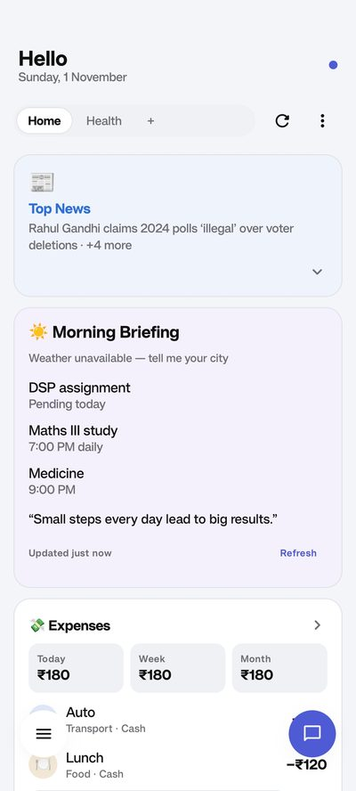
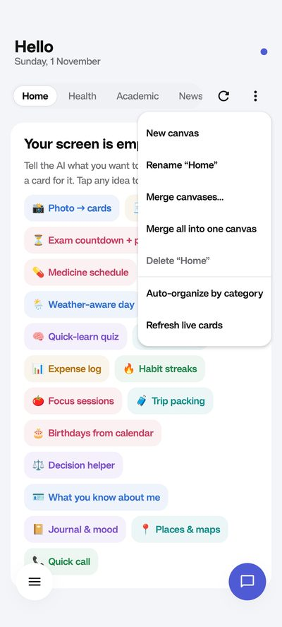
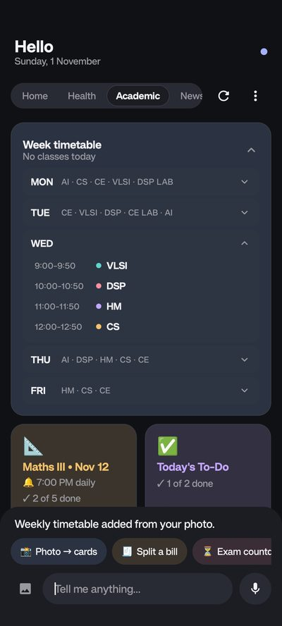
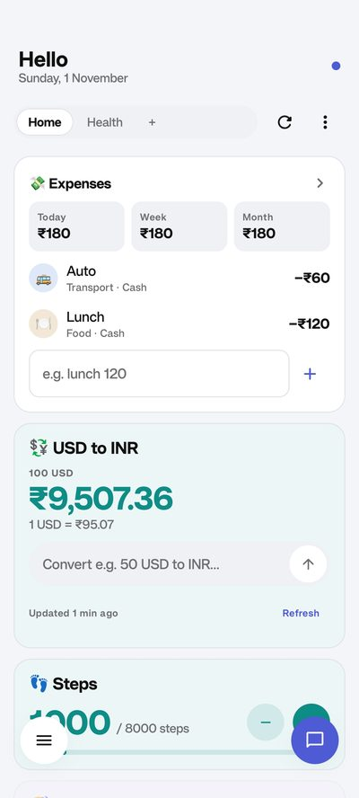
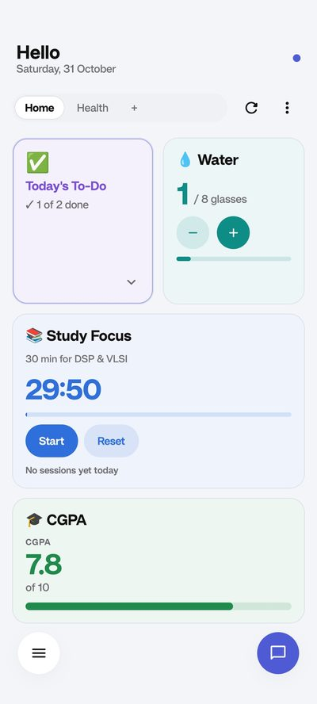
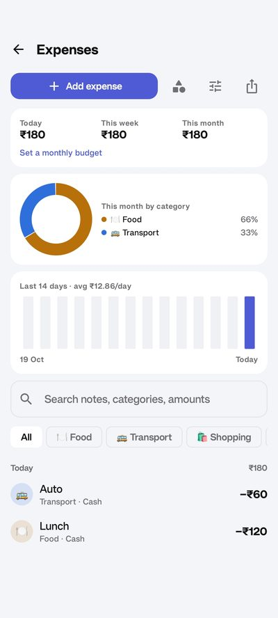
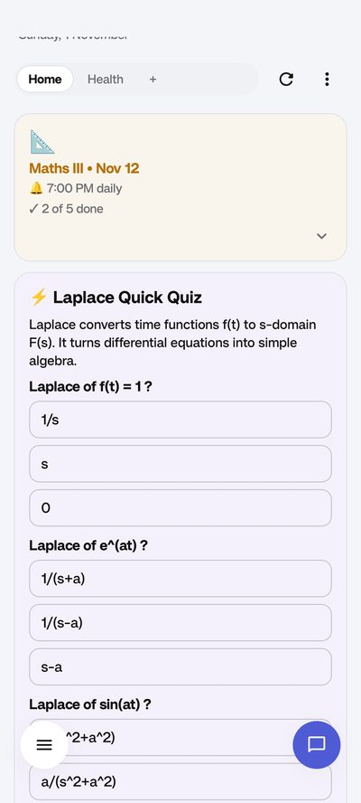
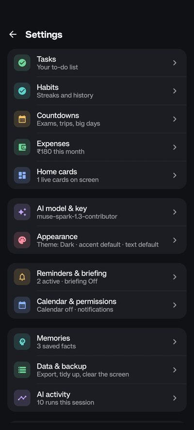

# AI Canvas

**Real-Time Generative User Interfaces with LLMs**

AI Canvas is an all-in-one personal app built on generative UI. Instead of switching between separate apps for tasks, habits, expenses, timetables, countdowns, news and weather, you just ask in chat, and the AI builds the exact card you need right on your home canvas.

Everything you care about stays in one place, and you can keep track of it all visually. Cards are generated by an LLM, checked against a fixed schema and drawn as native Jetpack Compose UI, so they stay fast, interactive and consistent. Live cards like news, weather and currency refresh by themselves every day.

## Screenshots

<table>
  <tr>
    <td align="center"><br><sub>Home canvas with news, briefing and expenses</sub></td>
    <td align="center"><br><sub>Ask in chat to create a card</sub></td>
    <td align="center"><br><sub>Week timetable card</sub></td>
    <td align="center"><br><sub>Live currency and expense cards</sub></td>
  </tr>
  <tr>
    <td align="center"><br><sub>To-do, focus timer and CGPA</sub></td>
    <td align="center"><br><sub>Expense tracker</sub></td>
    <td align="center"><br><sub>Generated quiz card</sub></td>
    <td align="center"><br><sub>Settings</sub></td>
  </tr>
</table>

## Features

- One app for everything: track tasks, habits, expenses, schedules and more visually
- Chat-driven creation and editing of home screen cards built from 12 UI building blocks
- Multiple canvases (tabs), card menus, reordering and auto-organize by category
- Built-in modules: tasks, habits, expenses, countdowns, schedule, focus timer
- Phone tools: reminders, calendar, morning briefing, currency and lookup, home screen widget
- Memory of user preferences and an AI activity log
- Bring your own API key; nothing is bundled in the app

## How it works

Message -> context + tools -> LLM JSON -> schema validation -> native Compose cards

## Setup

1. Open the project in Android Studio, or build from the command line:
   ```
   ./gradlew assembleDebug
   ```
2. Install the app, open **Settings -> AI model & key** and add your own API key.

Supported providers: Claude, or any OpenAI-compatible API such as OpenRouter, Gemini and NVIDIA.

Run the unit tests with `./gradlew testDebugUnitTest`.

## Download

The debug APK is available on the [Releases page](https://github.com/legit-wind/ai-canvas/releases/latest).

## Tech stack

Kotlin, Jetpack Compose, Material 3, Kotlin coroutines, Anthropic Java SDK, OkHttp, WorkManager, Gradle (Kotlin DSL), JUnit.

## Authors

- D. Kamesh (B240611EC)
- Kallu Prince Anvesh (B240810EC)

AI Course Mini Project, supervised by Dr. Karthik R.
